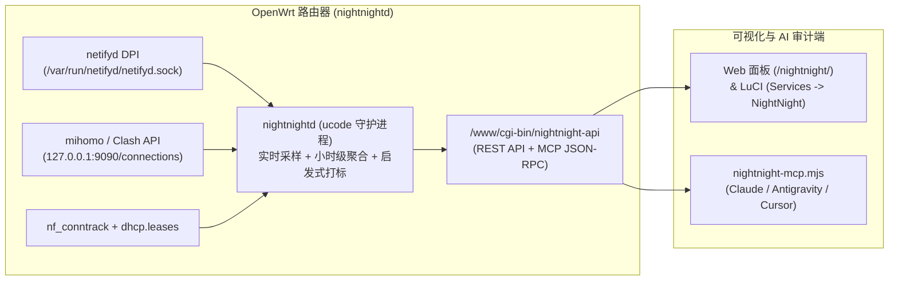

# luci-app-nightnight (`NightNight` OpenWrt 流量流向与隐私审计插件 + MCP Server)

> 灵感与交互设计源自 [@kevinzhow 的推文分享](https://x.com/kevinzhow/status/2120032317473456590)：在 OpenWrt 路由器上结合 **`netifyd` 深度包检测 (DPI)**、**`conntrack` / 透明代理连接追踪** 与 **MCP (Model Context Protocol)**，实时监控局域网每台设备的流量「来」和「去」，自动揪出后台大额静默上传、输入法云端上传、未加密明文传输与夜间偷跑流量。

---

## 核心特性

1. **多源融合采集（原生支持透明代理 / Fake-IP 环境）**
   - **`netifyd` DPI 引擎**：监听 `/var/run/netifyd/netifyd.sock`，提取 L7 应用协议、TLS SNI、证书信息与明文协议识别。
   - **`mihomo` / Clash API 融合**：自动读取本地 `127.0.0.1:9090/connections`（若运行了透明代理），完美还原 Fake-IP / Redir / TUN 模式下被代理连接的真实域名（`sniffHost` / `host`）与单条连接精确字节数。
   - **`/proc/net/nf_conntrack` 兜底**：对绕过代理的直连流量直接从内核连接跟踪表提取双向字节计数。
   - **极低资源占用**：后台守护进程 `nightnightd` 与 CGI 接口均采用 OpenWrt 原生 `ucode` 编写，无需安装 Python/Node/SQLite 到路由器，常驻内存仅 **~3.8 MB**。

2. **三合一可视化审计界面**
   - **实时拓扑流向图 (`实时拓扑`)**：左栏 `设备 · 谁在用` $\rightarrow$ 中间 `路由器` $\rightarrow$ 右栏 `去向 · 连到哪里`。动态贝塞尔曲线随实时速率变粗，橙色粒子代表上传（发出去）、蓝色粒子代表下载（收进来）。
   - **去向子域名下钻 (`去向主机名`)**：按累计上传流量降序排列所有目标主机名，直观展示 **上传**、**下载**、**连接数**、**最大单条连接**、**夜里上传 (00:00–06:00)** 与 **活跃时长**。
   - **查网站行为诊断 (`NightNight · 查网站`)**：自动根据连接频次、单次最大连接占比、上传/下载倍率生成自然语言诊断（*“它在干什么？少数几次大的上传：有 X 个小时里，单条连接传了超过 1 MB……”*）。

3. **启发式隐私标签引擎**
   - `共用云存储`：自动识别腾讯云 COS (`*.myqcloud.com`)、阿里云 OSS (`*.aliyuncs.com`)、AWS S3 等共用存储桶并提取桶名前缀线索。
   - `名字像输入法`：自动标记包含 `wxkb`（微信输入法）、`sogou`、`iflytek`、`input` 等特征的主机名。
   - `未加密`：自动标记使用 HTTP (80)、明文 MQTT 或非 TLS 端口传输数据的连接。
   - `遥测或日志`：自动识别 `metrics`、`telemetry`、`user-data`、`nel`、`beacon` 等遥测上报域名。

4. **原生支持 MCP (Model Context Protocol)**
   - 提供本地 Stdio 桥接器 (`mcp-server/nightnight-mcp.mjs`) 与路由器端直连 HTTP JSON-RPC 端点 (`/cgi-bin/nightnight-api?action=mcp`)，可在 **Claude Desktop**、**Claude Code**、**Antigravity**、**Cursor** 中直接用自然语言审计家庭网络设备行为。

---

## 系统架构



---

## 目录结构

```text
luci-app-nightnight/
├── Makefile                                                 # OpenWrt 标准包编译 Makefile
├── deploy.sh                                                # 一键通过 SSH 部署到路由器的脚本
├── mcp-server/
│   └── nightnight-mcp.mjs                                   # 本地 MCP Stdio 桥接服务 (供 Claude / Antigravity 调用)
└── root/
    ├── etc/init.d/nightnight                                # OpenWrt procd 自启动服务脚本
    ├── usr/sbin/nightnightd                                 # 核心流量采集与启发式审计守护进程 (ucode)
    ├── usr/share/luci/menu.d/luci-app-nightnight.json       # LuCI 菜单注册配置
    ├── usr/share/rpcd/acl.d/luci-app-nightnight.json        # LuCI 权限 ACL 配置
    └── www/
        ├── cgi-bin/nightnight-api                           # CGI 数据接口与远端 MCP Server 端点
        ├── luci-static/resources/view/nightnight/overview.js# LuCI 内嵌视图
        └── nightnight/                                      # 独立 Web 审计前端
            ├── index.html
            ├── style.css
            └── app.js
```

---

## 在 OpenWrt 路由器上部署

### 环境要求
- OpenWrt 22.03 / 23.05 / 24.10 / 25.12（使用 `ucode` 与 `procd`）
- 路由器需安装 `netifyd` 与 `ucode-mod-socket`

### 方式一：通过 SSH 一键部署（推荐）

1. **在路由器上安装依赖包**：
   - **OpenWrt 24.10 及更早版本 (`opkg`)**：
     ```bash
     ssh root@192.168.8.1 "opkg update && opkg install netifyd ucode-mod-socket conntrack"
     ```
   - **OpenWrt 25.12+ (`apk`)**：
     ```bash
     ssh root@192.168.8.1 "apk update && apk add netifyd ucode-mod-socket conntrack"
     ```

2. **执行一键部署脚本**：
   ```bash
   git clone https://github.com/bGl5b25nanVu/luci-app-nightnight.git
   cd luci-app-nightnight
   chmod +x deploy.sh
   ./deploy.sh root@192.168.8.1
   ```
   *(将 `192.168.8.1` 替换为你自己的 OpenWrt 路由器 IP)*

3. **打开 Web 界面**：
   - 独立全屏界面：`http://192.168.8.1/nightnight/`
   - LuCI 后台菜单：`http://192.168.8.1/cgi-bin/luci/admin/services/nightnight`（**服务 $\rightarrow$ NightNight 流量审计**）

---

### 方式二：使用 OpenWrt SDK 编译安装包

将本仓库放入 OpenWrt 源码树的 `package/luci-app-nightnight` 目录：

```bash
cp -r luci-app-nightnight /path/to/openwrt/package/
cd /path/to/openwrt
make menuconfig   # LuCI -> 3. Applications -> <*> luci-app-nightnight
make package/luci-app-nightnight/compile V=s
```

---

## 自定义设备名称

插件会自动读取 `/tmp/dhcp.leases` 中的主机名；对于未上报 DHCP 主机名的设备（如开启了私有无线地址的手机或静态 IP 设备），可在路由器上的 `/etc/nightnight/devices.json` 中自定义显示名称与图标（`laptop` 或 `phone`）：

```json
{
  "192.168.8.245": { "name": "MacBook-Pro", "icon": "laptop" },
  "192.168.8.208": { "name": "HOP-AL00", "icon": "phone" },
  "192.168.8.194": { "name": "Mac", "icon": "laptop" }
}
```

修改后执行 `/etc/init.d/nightnight restart` 即可生效。

---

## 接入 MCP (Claude / Antigravity / Cursor)

`NightNight` 内置了完整的 MCP 工具集，允许大模型直接查询你的路由器实时与历史审计数据。

### 提供的 MCP 工具列表

| 工具名称 | 功能说明 | 参数 |
| :--- | :--- | :--- |
| `nightnight_overview` | 获取路由器实时上传/下载速率、活跃设备列表、去向分类卡片及顶部异常告警 | 无 |
| `nightnight_suspicious_uploads` | 按可疑评分排序返回所有异常上传域名（大额单次上传、输入法特征、共用云存储、明文 HTTP、夜间上传） | `min_score` (可选，默认 `15`) |
| `nightnight_inspect_host` | 「查网站」：深入查询某个域名或 IP 的累计流量、最大单条连接、活跃小时分布及自然语言行为画像 | `host` (必填), `device` (可选，默认 `all`) |
| `nightnight_group_hosts` | 列出某个去向分类（`wechat`, `tencent`, `google`, `openai`, `alibaba`, `apple`, `huawei`, `unknown`, `all`）下的全部主机名明细 | `group_id` (可选，默认 `all`) |

---

### 1. 在 Antigravity 中配置

编辑 `~/.gemini/config/mcp_config.json`（及 `~/.gemini/settings.json`）：

```json
{
  "mcpServers": {
    "nightnight-openwrt": {
      "command": "/opt/homebrew/bin/node",
      "args": [
        "/ABSOLUTE/PATH/TO/luci-app-nightnight/mcp-server/nightnight-mcp.mjs"
      ],
      "env": {
        "NIGHTNIGHT_URL": "http://192.168.8.1/cgi-bin/nightnight-api?action=mcp"
      }
    }
  }
}
```
> 配置后在 Antigravity 右上角 **Additional Options (`...`) $\rightarrow$ MCP Servers** 刷新即可使用。

---

### 2. 在 Claude Desktop 中配置

编辑 `~/Library/Application Support/Claude/claude_desktop_config.json`（macOS）：

```json
{
  "mcpServers": {
    "nightnight-openwrt": {
      "command": "/opt/homebrew/bin/node",
      "args": [
        "/ABSOLUTE/PATH/TO/luci-app-nightnight/mcp-server/nightnight-mcp.mjs"
      ],
      "env": {
        "NIGHTNIGHT_URL": "http://192.168.8.1/cgi-bin/nightnight-api?action=mcp"
      }
    }
  }
}
```

---

### 3. 在 Claude Code CLI 中配置

可通过命令行一键添加，或写入 `~/.claude.json` 的 `mcpServers` 字段：

```bash
claude mcp add nightnight-openwrt \
  -e NIGHTNIGHT_URL="http://192.168.8.1/cgi-bin/nightnight-api?action=mcp" \
  -- /opt/homebrew/bin/node /ABSOLUTE/PATH/TO/luci-app-nightnight/mcp-server/nightnight-mcp.mjs
```

---

### 4. 常用 AI 审计提问示例

接入 MCP 后，你可以直接向 AI 提问：
- *“调用 nightnight 看看目前路由器上有哪些可疑的上传？”*
- *“帮我查一下家里哪些设备用明文 HTTP 传了数据？”*
- *“查一下 `play.googleapis.com` 和 `get.sogou.com` 在干什么，单次最大上传了多少？”*
- *“列出微信 (`wechat`) 分类下的所有子域名，看看有没有异常上传。”*

---

## REST API 调试说明

除 MCP JSON-RPC 外，路由器 CGI 还提供以下 GET 接口供二次开发或脚本调用：

- **概览与实时流向**：`GET http://192.168.8.1/cgi-bin/nightnight-api?action=overview`
- **按分类查询主机列表**：`GET http://192.168.8.1/cgi-bin/nightnight-api?action=hosts&id=wechat`
- **查网站深度分析**：`GET http://192.168.8.1/cgi-bin/nightnight-api?action=inspect&host=play.googleapis.com`
- **可疑上传排行**：`GET http://192.168.8.1/cgi-bin/nightnight-api?action=suspicious`

---

## License

[MIT License](./LICENSE)
